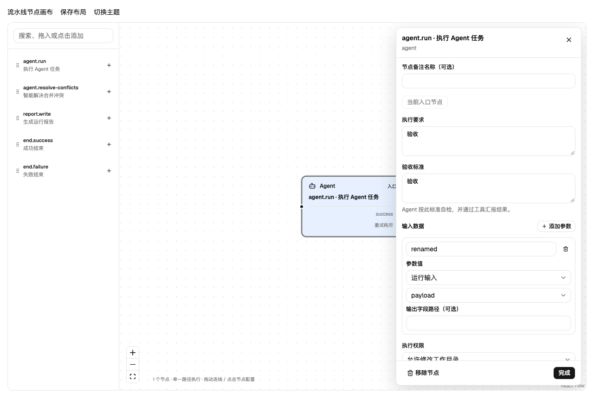
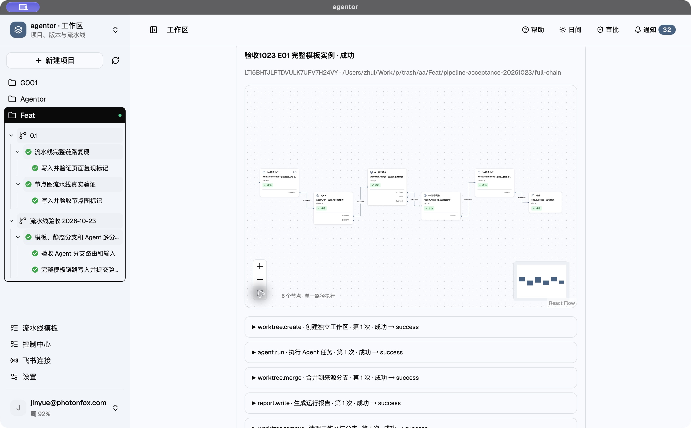
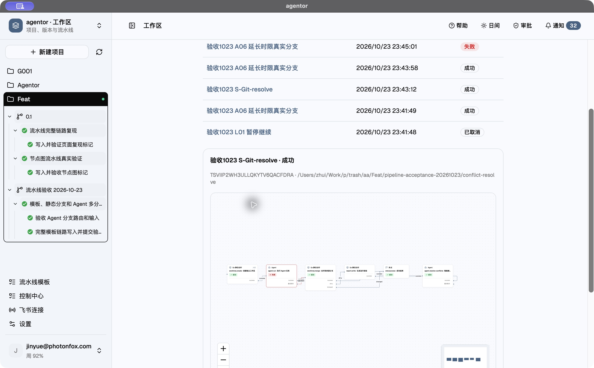

# Feat 流水线测试交付报告

测试日期：2026-10-23（Asia/Shanghai）  
范围：流水线模板、实例、运行输入、单 Step 绑定、六类静态节点、Agent 多分支、重试与失败处理、运行控制、Git 冲突解决、近期画布交互修改。

## 结论

完整模板链路、静态节点分支、Agent 三分支、失败重试、运行控制及智能冲突合并均取得符合预期的实际结果。下表保留 32 条验收记录：30 条通过、2 条首次超时，超时路径已在后续记录中补跑通过。**前端类型检查未通过，因此本轮不能判为可发布**。本轮仅新增测试与交付材料，未修复业务代码。

- 前端：原有 3 项浏览器测试、新增 4 项浏览器测试均通过。
- Go：pipeline、toolrouter、tasks、lifecycle、lark 共 137 条测试／子用例通过；6 个显式启用或辅助子进程入口跳过。
- Race：pipeline、toolrouter、tasks 共 78 条测试／子用例通过，4 个显式启用或辅助入口跳过，无竞争报告。
- 真实 Agent：初始请求存在超时；重连后成功验证的路径与原始失败记录均保留，不用模拟测试替代真实模型结果。
- 未包括：跨平台构建、外部消息发送、长时间压力测试、定时调度长期运行。

## 环境与方法

- 项目：Feat，ID `OZK6T6UTSA72SJGPJTK7ONAE7N`
- 原项目目录：`/Users/zhui/Work/p/trash/aa/Feat`
- 应用数据：`/Users/zhui/Library/Application Support/agentor`
- 新版本：流水线验收 2026-10-23（5Y5BVPO36V5TH3RNW7EWJKYFIH）
- 新需求：模板、静态分支和 Agent 多分支验收（3QITUIIFP6CPSW56BJCKQBZP5H）
- 模型：沿用应用的 `gpt-6.1-sol / low`；Codex CLI 0.162.1；macOS arm64；Go 1.26.0。
- 真实服务验收通过专用入口调用项目现有 SaveTemplate / Instantiate / RunTask / ControlRun 等方法，使用真实 Codex 工具汇报。没有把模拟输出写成真实执行结果。
- 经用户确认保存并退出桌面后独占应用数据；验收入口不启动飞书和定时调度。
- Git 用例在 Feat 下新建独立仓库 `pipeline-acceptance-20261023/`。仅在 RunTask 冻结上下文期间临时指定项目目录，立即恢复原目录。每次运行记录保存真实仓库路径。**这些 Git 用例复跑前应使用对应隔离目录；实例默认运行目录仍来自 Feat 当前项目配置。**
- 原有未跟踪文件 `readme` 未修改、未提交、未删除。
- 静态 Git 用例中的 `gate` 是刻意设置的短超时节点，失败后进入静态合并；测试驱动在此间准备 Git 状态。其红色状态是测试前置条件，不能解释为该用例的意外故障。
- “清理”用例按节点本职删除专属临时工作区与分支；来源仓库、提交、配置、需求、步骤、报告、执行记录均保留。其他工作区未清理。
- 桌面恢复后读取的是本机已有应用构建，用于核对真实结果和持久化；当前源码的界面回归通过浏览器组件夹具执行。未重新构建最新完整桌面包，不能把桌面截图作为最新界面样式已发布的证据。

## 每个验收路径与结果

| 编号／路径 | 判定 | 预期或实际关键结果 | Run ID／拒绝依据 | 证据 |
|---|---|---|---|---|
| S01 | 通过 | snapshot → report → success，报告保留 | ZUQBPZHMLVKRKKXWWQFBBU4D6D | [acceptance-results.json](acceptance-results.json) |
| S02 | 通过 | 静态异常只执行一次并失败 | GR737VALZGZCFAIUVMYPNP2M4Y | [acceptance-results.json](acceptance-results.json) |
| T01 | 通过 | 未绑定必填 Step 拒绝实例化 | 请绑定步骤插槽 choose | [acceptance-results.json](acceptance-results.json) |
| T02 | 通过 | 缺少必填运行输入拒绝启动 | 缺少输入 payload | [acceptance-results.json](acceptance-results.json) |
| T03 | 通过 | 修改模板不改变实例 | GMKZOPNUF4LM437FMEULEMJVC7 | [acceptance-results.json](acceptance-results.json) |
| A01-ready | 未通过／见说明 | 只走 ready 分支，输入原样透传 | ZTLU4DPJ24FXTNI2VGWWB6N546 | [acceptance-results.json](acceptance-results.json) |
| A01-review | 未通过／见说明 | 只走 review 分支，输入原样透传 | 62K466EV2OMLKIOKFV46AM7OT5 | [acceptance-results.json](acceptance-results.json) |
| A01-review | 通过 | 只走 review 分支 | QTEG6XCHLLJ5PTBAH4BCKQOM4F | [resume-results.json](resume-results.json) |
| A01-reject | 通过 | 只走 reject 分支，输入原样透传 | 4TYKTWK6XUHMJX5X6NDIDZD4JD | [resume-results.json](resume-results.json) |
| A02 | 通过 | 首次失败、第二次成功，共2次 | OIFTVS3Z3LYY6MU5KXARM3WNG5 | [resume-results.json](resume-results.json) |
| A03 | 通过 | 失败两次→处理报告→成功终点 | GTYXIUHFZRBLEBXVJNW3ESULTW | [resume-results.json](resume-results.json) |
| A04 | 通过 | 已汇报但未连接分支导致终止 | K3GXHU73FPHWI5IRBZ2I7F6HQR | [resume-results.json](resume-results.json) |
| S-Git-success | 通过 | 创建工作区 → 静态合并 success → 成功终点 | X6PC66QVN2ZTBGG5JNR3SP5YYE | [static-results.json](static-results.json) |
| S-Git-dirty | 通过 | 工作区有未提交修改 → dirty → 处理报告 → 成功终点 | 4SUQDYM55AVK64BH7YNZ6YRHFI | [static-results.json](static-results.json) |
| S-Git-diverged | 通过 | 来源与工作分支分叉 → diverged → 处理报告 → 成功终点 | CKGSNJXDRKLKQQDLVO467OCYKR | [static-results.json](static-results.json) |
| S-Git-unhandled | 通过 | dirty 未连接处理分支 → 按预期终止 | RXGSMT5M5DIQAWK6PVOZIRLI6U | [static-results.json](static-results.json) |
| S-Git-cleanup | 通过 | 合并 success → 清理专属工作区和分支 → 成功终点 | J3KUUVAQ4XELN2DH2FKEVQU7FX | [static-results.json](static-results.json) |
| S03 | 通过 | 读取本轮知识文档 → 输出传给报告 → 成功终点 | 4W6WUOE3N7CQNR2KTATSG3BEK7 | [followup-results.json](followup-results.json) |
| A05 | 通过 | 两次超时 → 重试耗尽 → 处理报告 → 成功终点 | F274NPTIMAVOCDB5KWXN7HM4OK | [followup-results.json](followup-results.json) |
| L01-pause | 通过 | 运行中暂停，状态变为 paused | NYI7QRTHPQNMYLD5NBM2K6GWHI | [followup-results.json](followup-results.json) |
| L01-resume | 通过 | 继续暂停的运行 → 报告 → 成功终点 | NYI7QRTHPQNMYLD5NBM2K6GWHI | [followup-results.json](followup-results.json) |
| L02-stop | 通过 | 停止运行 → cancelled | Q6T6UGZBVA7DUGM2FYVSFJTDJU | [followup-results.json](followup-results.json) |
| A06 | 通过 | 延长时限后实际汇报 ready；对象、数字、布尔值原样透传 | 4ZZZPDATZQSNUDETFLMH64IUOA | [followup-results.json](followup-results.json) |
| S-Git-resolve | 通过 | 静态合并 diverged → 真实 Agent 解决冲突并提交 → 来源分支更新 → 成功终点 | TSVIIP2WH3ULLQKYTV6QACFDRA | [conflict-results.json](conflict-results.json) |
| E01 | 通过 | 模板→绑定步骤→独立工作区→真实 Agent 提交→合并→报告→清理→成功 | LTI5BHTJLRTDVULK7UFV7H24VY | [e2e-results.json](e2e-results.json) |
| V-循环连线 | 通过 | 节点图包含循环：choose；请使用 Agent 节点的有限重试 | 节点图包含循环：choose；请使用 Agent 节点的有限重试 | [validation-results.json](validation-results.json) |
| V-不存在的目标节点 | 通过 | 节点 choose 的目标 missing 不存在 | 节点 choose 的目标 missing 不存在 | [validation-results.json](validation-results.json) |
| V-空提示词 | 通过 | Agent 节点 choose 必须填写提示词和验收标准 | Agent 节点 choose 必须填写提示词和验收标准 | [validation-results.json](validation-results.json) |
| V-必填步骤清空 | 通过 | 请绑定步骤插槽 choose | 请绑定步骤插槽 choose | [validation-results.json](validation-results.json) |
| V-未来节点输出引用 | 通过 | 结果 ready-report 不是节点 choose 在所有路径上的前序节点 | 结果 ready-report 不是节点 choose 在所有路径上的前序节点 | [validation-results.json](validation-results.json) |
| V-重复分支名称 | 通过 | 节点 choose 分支名称为空、保留名称或重复 | 节点 choose 分支名称为空、保留名称或重复 | [validation-results.json](validation-results.json) |
| V-运行输入类型错误 | 通过 | 输入 route 应为 string | 输入 route 应为 string | [validation-results.json](validation-results.json) |

“未通过”中的早期 A01-ready、A01-review 为原始 120 秒超时；后续 A06、A01-review 补跑及 A01-reject 分别记录真实分支结果。终点是 end.failure 的 reject 路径，运行显示 error 是预期行为。

### 实际运行轨迹

| Run ID | 流水线 | 节点路径 | 最终状态 | 错误／预期终止说明 |
|---|---|---|---|---|
| ZUQBPZHMLVKRKKXWWQFBBU4D6D | 验收1023 S01 快照与报告 | snapshot (success) → report (success) → done | completed |  |
| GR737VALZGZCFAIUVMYPNP2M4Y | 验收1023 S02 知识不存在 | knowledge (error) | error | 文档不存在 |
| ZTLU4DPJ24FXTNI2VGWWB6N546 | 验收1023 A01 三分支实例 | choose (error) | error | context deadline exceeded |
| 62K466EV2OMLKIOKFV46AM7OT5 | 验收1023 A01 三分支实例 | choose (error) | error | context deadline exceeded |
| 4RTMHV7WN2RALA6WJVX5OO5RW4 | 验收1023 A01 三分支实例 | choose (interrupted) | cancelled | context canceled |
| X6PC66QVN2ZTBGG5JNR3SP5YYE | 验收1023 S-Git-success | create (success) → gate (error) → merge (success) → done | completed |  |
| 4SUQDYM55AVK64BH7YNZ6YRHFI | 验收1023 S-Git-dirty | create (success) → gate (error) → merge (dirty) → dirty (success) → done | completed |  |
| CKGSNJXDRKLKQQDLVO467OCYKR | 验收1023 S-Git-diverged | create (success) → gate (error) → merge (diverged) → diverged (success) → done | completed |  |
| RXGSMT5M5DIQAWK6PVOZIRLI6U | 验收1023 S-Git-unhandled | create (success) → gate (error) → merge (dirty) | error | 节点 merge 的结果 dirty 没有连接处理分支 |
| J3KUUVAQ4XELN2DH2FKEVQU7FX | 验收1023 S-Git-cleanup | create (success) → gate (error) → merge (success) → cleanup (success) → done | completed |  |
| 4W6WUOE3N7CQNR2KTATSG3BEK7 | 验收1023 S03 读取知识成功 | knowledge (success) → report (success) → done | completed |  |
| F274NPTIMAVOCDB5KWXN7HM4OK | 验收1023 A05 超时重试耗尽 | timeout (error) → timeout (error) → handled (success) → done | completed |  |
| NYI7QRTHPQNMYLD5NBM2K6GWHI | 验收1023 L01 暂停继续 | gate (error) → report (success) → done | completed |  |
| Q6T6UGZBVA7DUGM2FYVSFJTDJU | 验收1023 L01 暂停继续 | gate (interrupted) | cancelled | context canceled |
| 4ZZZPDATZQSNUDETFLMH64IUOA | 验收1023 A06 延长时限真实分支 | choose (ready) → ready-report (success) → done | completed |  |
| TSVIIP2WH3ULLQKYTV6QACFDRA | 验收1023 S-Git-resolve | create (success) → gate (error) → merge (diverged) → resolve (success) → done | completed |  |
| QTEG6XCHLLJ5PTBAH4BCKQOM4F | 验收1023 A06 延长时限真实分支 | choose (review) → review-report (success) → done | completed |  |
| 4TYKTWK6XUHMJX5X6NDIDZD4JD | 验收1023 A06 延长时限真实分支 | choose (reject) → reject-report (success) → failed | error | 到达失败终点 failed |
| OIFTVS3Z3LYY6MU5KXARM3WNG5 | 验收1023 A02 重试后成功 | retry (error) → retry (success) → done | completed |  |
| GTYXIUHFZRBLEBXVJNW3ESULTW | 验收1023 A03 耗尽后处理 | fail (error) → fail (error) → handled (success) → done | completed |  |
| LTI5BHTJLRTDVULK7UFV7H24VY | 验收1023 E01 完整模板实例 | create (success) → develop (success) → merge (success) → report (success) → cleanup (success) → done | completed |  |
| K3GXHU73FPHWI5IRBZ2I7F6HQR | 验收1023 A04 未连接分支 | loose (success) | error | 节点 loose 的结果 success 没有连接处理分支 |

完整节点输入、输出、工具汇报、会话与轮次 ID、提交 ID 保存在 [current-state.json](current-state.json) 及逐次 `run-<ID>.json` 中。无效配置保存在 `invalid-*.json`，由于校验拒绝，它们不会进入应用模板列表。

### 两条关键链路的落地证据

- **E01 完整模板链路**：模板 `XQ2MCSLVQG6GBV23DWI6MUBLHP` 创建实例 `52YXHEQXL2TZPKQLLJJ3IV35VS`，绑定 Step `VJ5LUT3B27YHGG5TMD35RYDOX5`。Agent 在独立工作区提交 `acceptance-e2e.txt`，来源仓库保留内容 `PIPELINE_E2E_1023` 加换行；合并、报告、工作区清理和成功终点均完成。
- **S-Git-resolve 冲突链路**：先构造真实 Git 冲突，静态节点走 `diverged`，Agent 合并后 `fixture.txt` 同时保留 `SOURCE` 和 `WORKTREE` 两行，合并提交为 `75dee43c6b041ad87b90c1e5ca2c171cb56ad612`，来源分支已更新，解决冲突的工作区保留。该链路中的 gate 超时是专门设置的前置条件。
- 两个绑定 Step 与需求最终均显示完成，见 [项目最终状态](feat-workspace.json) 和 [步骤执行记录](step-executions.json)。

## 界面回归

| 用例 | 验证内容 | 结果 |
|---|---|---|
| UI01 | 拖入节点、连接、编辑分支、拖动、保存重载、深色主题及窄布局 | 通过 |
| UI02 | 自由 JSON 输入保留类型，无效输入阻止运行 | 通过 |
| UI03 | 缩略图 SVG 位于容器边界内 | 通过 |
| UI04 | 已连接出口拖至空白解除原连接，合法端点显示蓝色吸附圈；贝塞尔路径、无标签背景 | 通过 |
| UI05 | Agent 参数表单读取已有引用、重命名后值保留、添加与删除参数 | 通过 |
| UI06 | 智能冲突节点自动填充提示词和验收标准；遮罩不透明度 55% | 通过 |
| UI07 | 模板步骤绑定开关自动设置／清空单 Step 绑定标识 | 通过 |

证据：[原有浏览器测试](browser-tests.log)、[新增交互测试](new-browser-tests.log)、[步骤开关测试](step-switch-test.log)。浏览器用例使用真实 React 组件和隔离预览夹具，**不等同于每项都在桌面 WebView 中复测**。

## 缺陷与运行风险

### D01：前端类型检查失败（发布阻断）

`frontend/src/features/pipeline/NodeEditor.tsx` 第 80、94 行调用 `Object.hasOwn`，但 tsconfig 的 target/lib 为 ES2020，导致 TS2550。证据：[typecheck.log](typecheck.log)。

当前 Vite 开发界面可运行，但 `npm run build` 先执行 tsc，会被同一错误阻断。建议后续做最小修复，改用现有编译目标支持的属性检查方式，再重新验证类型检查。本轮未修改。

### R01：真实模型连接不稳定

首次两个业务分支请求在 120 秒后超时；第三次原始请求由测试人员取消以避免持续重复请求。诊断日志捕获 `responseStreamDisconnected`、`Connection reset by peer (os error 54)` 和 `request timed out`，随后原生运行时自动重连。后续成功不抹去这些原始失败，生产运行仍需考虑真实网络波动。

证据：[service.log](service.log)、[原始验收日志](acceptance.log)、[补跑日志](resume.log)。

### 测试驱动自身问题

初始化测试时先遇到本机沙箱缓存权限及 CGO 未启用，按项目要求启用 CGO 后完成检查。验收驱动还修正了未连接用例的不可达多余节点、知识根节点参数、记录脚本局部变量问题。它们属于测试夹具错误，修正后从未完成用例继续；原日志保留，未计为业务缺陷。

## 关键截图

参数表单截图来自当前源码的组件回归；另两张来自恢复后的本机已有桌面构建，展示 Feat 持久化结果。

## 留存与复核

- 应用中查找名称前缀 **验收1023**：共保留 2 个模板、17 个实例、22 次运行。
- Feat 的 **流水线验收 2026-10-23** 版本中保留本轮需求和步骤。
- [原始数据与运行快照](current-state.json)；[逐条自动化记录](automated-test-details.md)；[测试上下文](created-context.json)。
- 真实服务驱动位于 `cmd/pipeline-acceptance/main.go`；本目录内 `*-acceptance.mjs` 为留存的测试脚本。驱动只能在桌面已退出、无其他数据写入者时启动，结束后关闭；不要与桌面并行运行。
- 验收入口已关闭，22 次运行均已结束，Agentor 桌面应用已恢复。
- 本轮未提交或推送 agentor 源码；隔离 Git 仓库中的提交是验收动作的一部分。未清理测试配置或运行历史。
